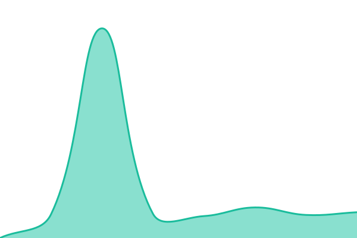
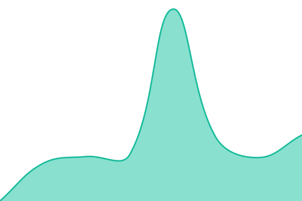
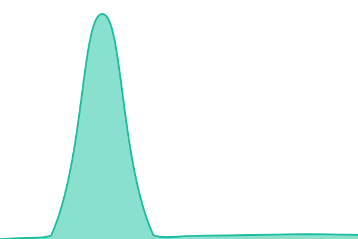

# [📈 Live Status](https://status.feasable.org): <!--live status--> **🟩 All systems operational**

This repository contains the open-source uptime monitor and status page for [Feasable Labs](feasable.org), powered by [Upptime](https://github.com/upptime/upptime).

With [Upptime](https://upptime.js.org), you can get your own unlimited and free uptime monitor and status page, powered entirely by a GitHub repository. We use [Issues](https://github.com/feasable/feasable-uptime/issues) as incident reports, [Actions](https://github.com/feasable/feasable-uptime/actions) as uptime monitors, and [Pages](https://status.feasable.org) for the status page.

<!--start: status pages-->
<!-- This summary is generated by Upptime (https://github.com/upptime/upptime) -->
<!-- Do not edit this manually, your changes will be overwritten -->
<!-- prettier-ignore -->
| URL | Status | History | Response Time | Uptime |
| --- | ------ | ------- | ------------- | ------ |
|  [Feasable API](https://api.feasable.org/v1/health) | 🟩 Up | [feasable-api.yml](https://github.com/feasable/feasable-uptime/commits/HEAD/history/feasable-api.yml) | 

 6473ms
     
 | 

<a href="https://status.feasable.org/history/feasable-api">100.00%</a>
    

|  [Feasable Payments](https://pay.feasable.org/v1/health) | 🟩 Up | [feasable-payments.yml](https://github.com/feasable/feasable-uptime/commits/HEAD/history/feasable-payments.yml) | 

 1703ms
     
 | 

<a href="https://status.feasable.org/history/feasable-payments">100.00%</a>
    

|  [Feasable Checkout](https://checkout.feasable.org/v1/health) | 🟩 Up | [feasable-checkout.yml](https://github.com/feasable/feasable-uptime/commits/HEAD/history/feasable-checkout.yml) | 

 1141ms
     
 | 

<a href="https://status.feasable.org/history/feasable-checkout">100.00%</a>
    

|  [Feasable Staging API](https://staging-api.feasable.org/v1/health) | 🟩 Up | [feasable-staging-api.yml](https://github.com/feasable/feasable-uptime/commits/HEAD/history/feasable-staging-api.yml) | 

 1051ms
     
 | 

<a href="https://status.feasable.org/history/feasable-staging-api">100.00%</a>
    

|  [Feasable Staging Payments](https://staging-pay.feasable.org/v1/health) | 🟩 Up | [feasable-staging-payments.yml](https://github.com/feasable/feasable-uptime/commits/HEAD/history/feasable-staging-payments.yml) | 

 2380ms
     
 | 

<a href="https://status.feasable.org/history/feasable-staging-payments">100.00%</a>
    

|  [Feasable Staging Checkout](https://staging-checkout.feasable.org/v1/health) | 🟩 Up | [feasable-staging-checkout.yml](https://github.com/feasable/feasable-uptime/commits/HEAD/history/feasable-staging-checkout.yml) | 

 5477ms
     
 | 

<a href="https://status.feasable.org/history/feasable-staging-checkout">100.00%</a>
    

|  [UptimeKit Dashboard](https://uptime.feasable.org/api/health) | 🟩 Up | [uptime-kit-dashboard.yml](https://github.com/feasable/feasable-uptime/commits/HEAD/history/uptime-kit-dashboard.yml) | 

 2837ms
     
 | 

<a href="https://status.feasable.org/history/uptime-kit-dashboard">100.00%</a>
    

|  [Feasable Status Page](https://status.feasable.org/) | 🟩 Up | [feasable-status-page.yml](https://github.com/feasable/feasable-uptime/commits/HEAD/history/feasable-status-page.yml) | 

 156ms
     
 | 

<a href="https://status.feasable.org/history/feasable-status-page">100.00%</a>
    

|  [Para Free Proxy](https://api.parastus.me/api/ping) | 🟩 Up | [para-free-proxy.yml](https://github.com/feasable/feasable-uptime/commits/HEAD/history/para-free-proxy.yml) | 

 6674ms
     
 | 

<a href="https://status.feasable.org/history/para-free-proxy">100.00%</a>
    

<!--end: status pages-->

[**Visit our status website →**](https://status.feasable.org)

## 📄 License

- Powered by: [Upptime](https://github.com/upptime/upptime)
- Code: [MIT](./LICENSE) © [Anand Chowdhary](https://anandchowdhary.com)
- Data in the `./history` directory: [Open Database License](https://opendatacommons.org/licenses/odbl/1-0/)
